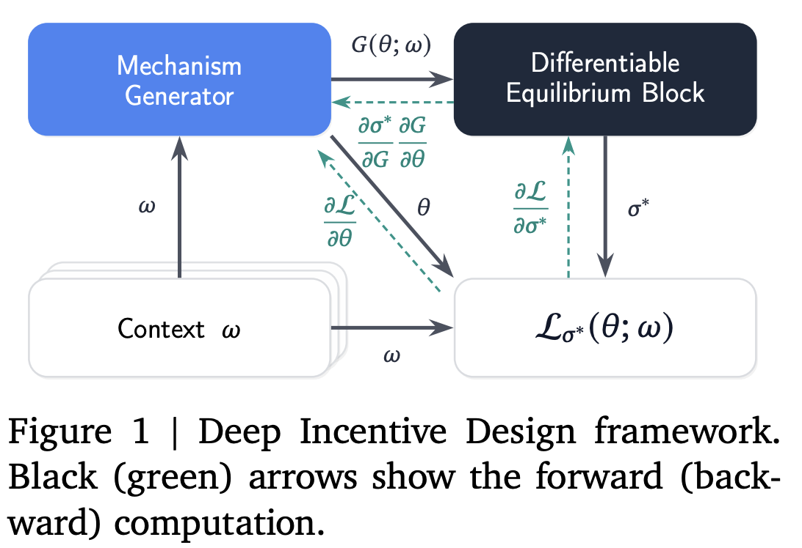
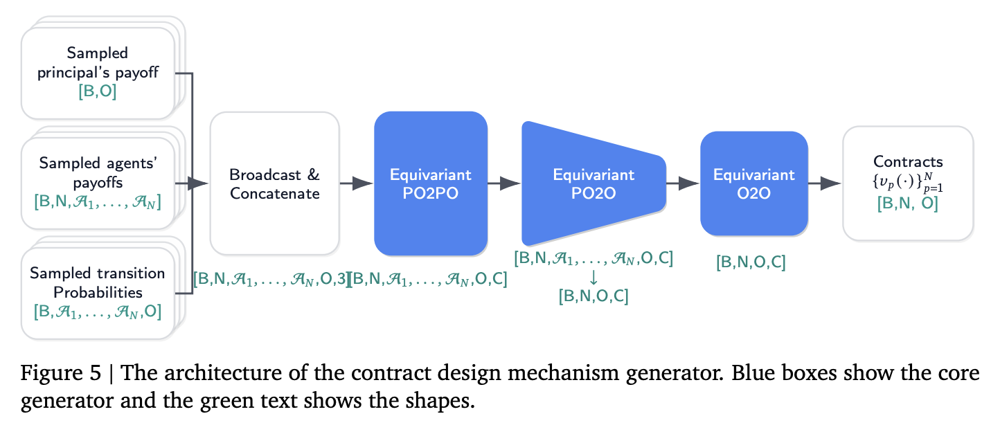
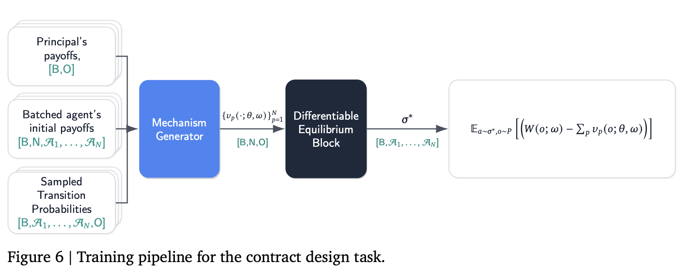
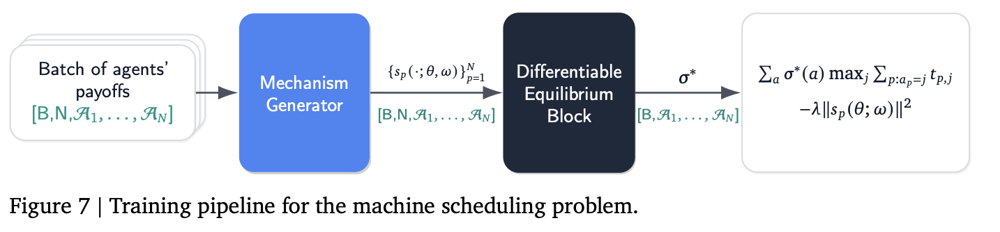

# Deep Incentive Design with Differentiable Equilibrium Blocks

> [!WARNING]
> Due to the intensive compuational resources needed for the experiments,
> this the section of the experiments is `yet` purely for demostration.

## API

```python
task = designer.Task.MACHINE_SCHEDULLING #designer.Task.CONTRACT_DESIGN

generator_rng = jax.random.key(seed)

if task == designer.Task.MACHINE_SCHEDULLING:
    sampler = samplers.SchedulingSampler(
        num_players=num_players,
    )
    task_def = designer.define_machine_schedulling_task(
        sampler=sampler,
        tax_ramp_steps=1000,
    )
    generator = generators.SchedulingGenerator(
        num_players=num_players,
        channel_list=[32, 32],
        rngs=nn.Rngs(generator_rng),
    )
elif task == designer.Task.CONTRACT_DESIGN:
    sampler = samplers.ContractDesignSampler(
        num_players=num_players,
    )
    task_def = designer.define_contract_design_task(
        sampler=sampler, payment_ramp_steps=1000
    )
    generator = generators.ContractDesignGenerator(
        num_players=num_players,
        po2po_channels=32,
        o2o_channels=32,
        num_po2po=3,
        num_o2o=2,
        rngs=nn.Rngs(generator_rng),
    )
else:
    raise ValueError("Unspecified task!")

deb = equilibrium_block.DEB.from_config(config_file="deb_config.json")
assert deb._num_players == num_players, "Incompatible DEB!"

didesigner = designer.MechanismGeneratorDesigner(
    num_players=num_players,
    task=task_def,
    generator=generator,
    deb=deb,
    batch_size=32,
    base_learning_rate=1e-3,
    network_train_steps=100_000,
    seed=seed,
    log_every=1000,
    eval_every=0,
    warmup_steps=1000,
)

didesigner.solve()
```

The main driver file is

```Bash
>> python did_main.py --help
>> did_main.py:
  --base_learning_rate: Learning rate of the solver`s updates.
    (default: 0.0001) (a number)
  --batch_size: Number of transitions to sample at each learning step.
    (default: 64) (an integer)
  --cd_max_actions: Number of maximum actions for the contract design.
    (default: 16) (an integer)
  --cd_max_cost: Maximum cost for the contract design.
    (default: 0.0) (a number)
  --cd_max_outcome: Maximum outcome for the contract design.
    (default: 5.0) (a number)
  --cd_max_outcomes: Number of maximum outcomes for the contract design.
    (default: 10) (an integer)
  --cd_min_actions: Number of minimum actions for the contract design.
    (default: 2) (an integer)
  --cd_min_cost: Minimum cost of the contract design.
    (default: -4.0) (a number)
  --cd_min_outcome: Minimum outcome of the contract design.
    (default: -5.0) (a number)
  --cd_min_outcomes: Number of minimum actions for the contract design.
    (default: 2) (an integer)
  --cd_transition_alpha: Discounting coeff. for the contract design.
    (default: 0.1) (a number)
  --checkpoint_dir: Directory to save/load the agent models.
    (default: '/tmp/did_test')
  --deb_config_file: A JSON file with the DEB configuration.
  --eval_batch_size: Number of transitions to sample at each evaluation step.
    (default: 10)  (an integer)
  --eval_every: Episode frequency of the evaluation.
    (default: 10) (an integer)
  --iterations: Number of training episodes.
    (default: 60000) (an integer)
  --log_every: Episode frequency at which the design process is evaluated.
    (default: 5000) (an integer)
  --max_grad_norm: Max allowed gradient norm.
    (default: 1.0) (a number)
  --ms_max_machines: Number of maximum machines for the machine schedulling.
    (default: 12) (an integer)
  --ms_max_tax_weight: Maximum weight for the tax regulariser.
    (default: 0.1) (a number)
  --ms_min_machines: Number of minimum machines for the machine schedulling.
    (default: 2) (an integer)
  --ms_time_sigma: Std. deviation of the LogNormal times distribution.
    (default: 0.5) (a number)
  --num_players: Number of players for the task. (an integer)
  --seed: A random seed.
    (default: 42) (an integer)
  --task: <CONTRACT_DESIGN|MACHINE_SCHEDULLING>: What task, MACHINE_SCHEDULLING or CONTRACT_DESIGN are we adapting to?
    (default: 'CONTRACT_DESIGN')
  --task_warm_up_steps: Warm up for the task schedule.
    (default: 1000) (an integer)
  --[no]use_checkpoints: Save/load neural network weights. (default: 'false')
  --warmup_steps: Warmup rate for the solver`s updates.
    (default: 1000) (an integer)
```

> [!IMPORTANT]
> As can be seen, you need a pretrained Differentialble Equilibrium block config. You can obtain it from the [NES](../nes/README.md), either running [its driver file](../nes_main.py) with a flag `--save_for_deb=true` or saving the solver with `nesolver.save(save_network_config=True)`.

### Motivation

Game-theoretic equilibria provide us with the language to describe and study multi-agent interactions. Many works have focused on their computation and the respective complexity classes. In contrast, from a policy-making perspective, we typically want to solve the inverse problem of setting up the rules of a game to guarantee desirable equilibrium outcomes. In economics, for example, institutions design taxes or markets with the aim of improving social welfare or revenue at the anticipated equilibrium behaviour. Similarly, as we create agentic AIs interacting with each other, our aim is to set up incentives such that the resulting behaviour is aligned with societal welfare.

Incentive design problem
$$
\min_\theta \mathbb{E}_{\omega\sim\Omega} \left[ \mathcal{L}_{\sigma^\star}(\theta; \omega) \right] \quad \text{s.t. } \sigma^\star \in \text{Eql}(G(\theta;\omega)) 
$$

### Method



DID training loop: context sampler -> generator -> induced game -> frozen DEB -> loss.

In more detailed view,


```
    ctx ~ sampler                       (task context: costs/transitions/W or processing times)
     |
     v
    generator(ctx)                      contracts [B, N, O]  |  taxes [B, N, A1..AN]   (trainable)
     |
     v
    induced_game(ctx, out)              G = initial payoffs + intervention             [B, N, A1..AN]
     |
     v
    FrozenDEB(G, masks)  ->  sigma*     eps-ME-(C)CE, weights frozen, differentiable w.r.t. G
     |
     v
    loss(sigma*, ctx, out, weight)      task loss with the paper's ramped regulariser weight
     |
     v
    grads -> generator params ONLY      (the optimiser is built on the generator alone)
```

The structure copies [`nes.NESolver`](../nes/solver.py) on purpose. The DEB is a separate object closed over by the jitted function, so its weights are constants of the graph: gradients flow THROUGH it to the generator's output
but nothing updates it.

## Models

### Contract design





### Machine Schedulling



## Differences with the paper:
1. As [NES](../nes/README.md) was implemented first, we follow its notation (channels-first), so, for example, contranct design batch is shaped as `[B, C, N, A1,..., AN, O]`.
2. The paper does not say how the equilibrium constraint is handled during that local search; this is a standard way to do it with an unconstrained,derivative-free method:
    * sigma is parametrised as a softmax over free logits restricted to the VALID joint actions, so every iterate is a probability distribution by construction;
    * leaving the eps-(C)CE set is discouraged with a quadratic penalty on the (C)CE gap, which is measured relative to eps (see `build_gap_fn`).
3. Inverse equilibrium task is still up for grabs — it needs a separate [paper](https://arxiv.org/abs/2304.09978) for the regualiser.